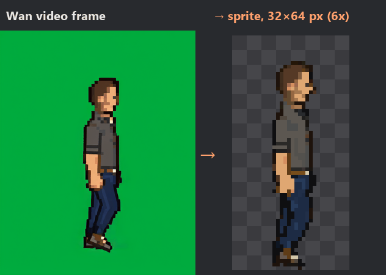
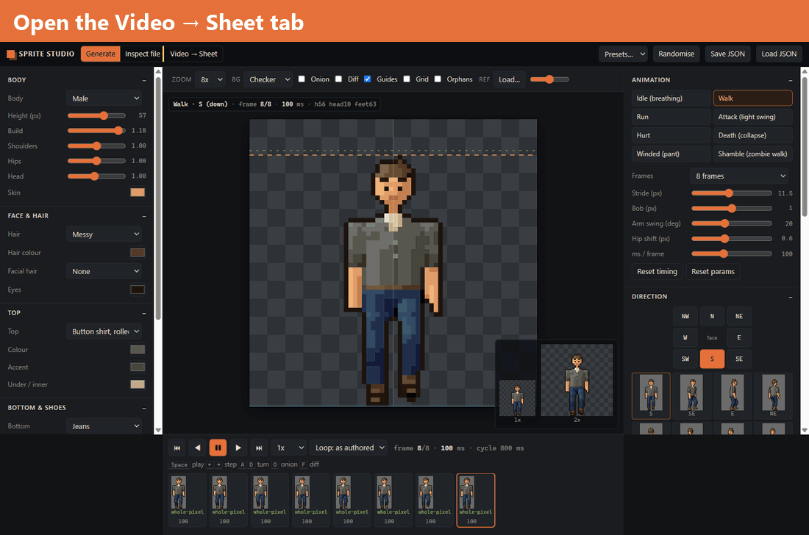
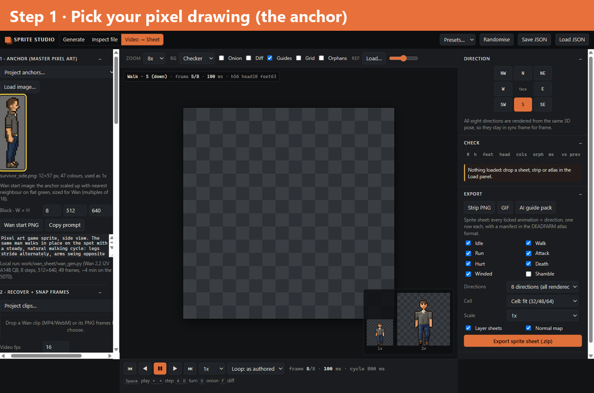
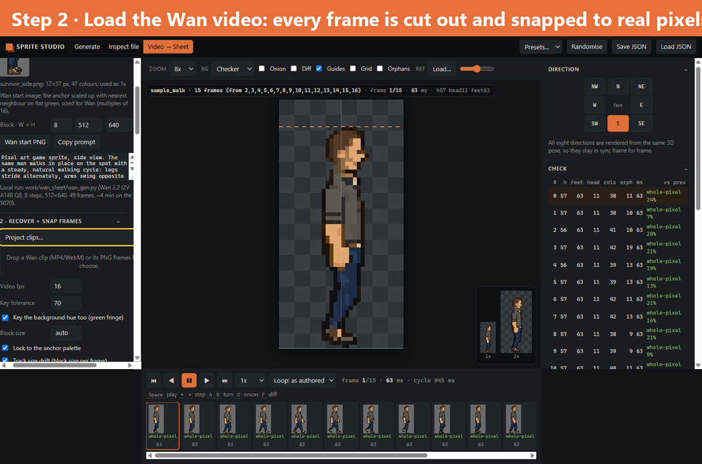
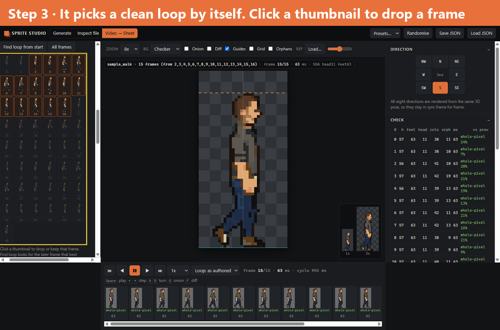
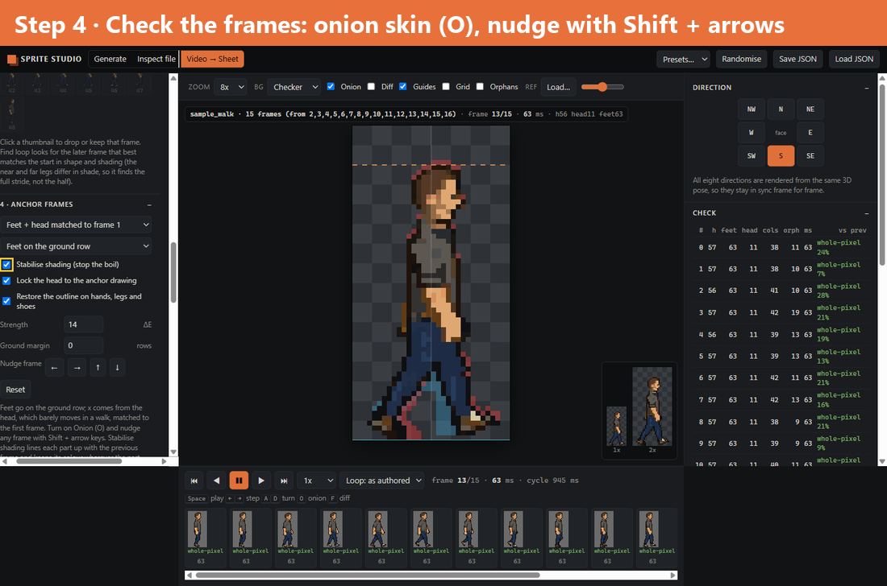
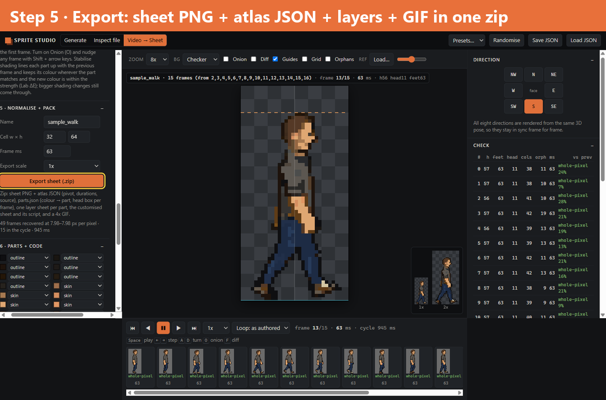
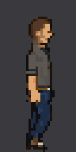
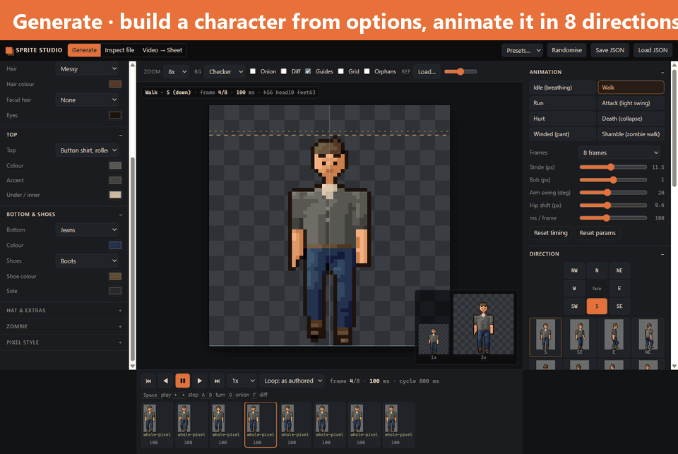

# Sprite Studio

A browser tool for pixel-art game characters. It has three modes:

- **Generate:** build a character from options and animate it in 8 directions.
- **Inspect file:** check any sprite sheet frame by frame.
- **Video → Sheet:** turn an AI video of your character (Wan 2.2) into a clean, game-ready sprite sheet.

It's plain HTML and JavaScript, with no install, no build step and no network calls.

<p align="center">
  
</p>

## Quick start

```bash
git clone https://github.com/zenith4eva/sprite-studio.git
cd sprite-studio
python -m http.server 5190
```

Open **http://localhost:5190/** in Chrome, Edge or Firefox.

> Serve the folder rather than double-clicking `index.html`. Browsers block a page opened from disk from reading the sample images.

---

## Video → Sheet, step by step

AI video models are good at motion and bad at pixel art: the frames come out blurry, about 8 times too big, on a green background, and the colours drift. This mode keeps the **motion** from the video and takes the **look** (size, colours, face) from your own pixel drawing.

```
your pixel drawing ──► Wan start image ──► Wan makes a ~3 s clip of it walking
                                                     │
your pixel drawing ◄──── used as the reference ──────┤
                                                     ▼
          every frame is cut out, shrunk back to real pixels and recoloured with only your drawing's colours
                                                     ▼
                        a clean loop is picked ──► feet lined up ──► sprite sheet
```

<p align="center"></p>

The repo ships with a sample drawing and a sample 49-frame Wan clip, so you can try every step right away.

### 0 · Open the tab

Click **Video → Sheet** at the top. The left panel now shows sections 1 to 6. You only *need* sections 1, 2 and 5. The others are for fixing things.

### 1 · Pick your pixel drawing (the anchor)



In **1 · Anchor**, open **Project anchors…** and choose **Sample: survivor, side**. You can also click **Load image…** to use your own drawing.

- A 1x drawing (for example 32×64) is used as is.
- A large AI image is fine too. It is keyed, cut to the figure and snapped to true pixels automatically.

The drawing's colours become the **only** colours allowed in every frame. Its head is also reused on every frame, so the face never flickers.

### 2 · Load the video



In **2 · Recover + snap**, open **Project clips…** and choose **Sample: Wan 2.2 walk in place**. You can also drop your own MP4/WebM, or a folder's worth of PNG frames, onto the drop box.

It starts on its own. For every frame it:

1. removes the green background
2. finds the figure (never a fixed grid crop)
3. shrinks it back to real pixels at the drawing's size
4. recolours it with the drawing's palette

You don't press anything. **Recover + snap** is only for re-running after you change a setting.

### 3 · Check the loop



The tool already picked one clean walk cycle: the highlighted thumbnails. The first ~10 frames are skipped on purpose, because that's the video easing in from the still image. The middle viewer plays the result.

- **Click a thumbnail** to drop or restore that frame.
- **from / to** sets the range by hand. **Find loop from start** re-picks it.
- **Space** plays or pauses, **← / →** step frame by frame.

### 4 · Fix small things (optional)



- **O** turns on onion skin: red is the previous frame, blue the next.
- **Shift + arrow keys** nudge the current frame by 1 pixel.
- For **runs and jumps**, switch *Feet on the ground row* to **Height from the video**, so the feet can leave the ground.
- Keep the three checkboxes on. They stop colour flicker, lock the face to your drawing and repair outlines on hands and shoes.

### 5 · Export



In **5 · Normalise + pack**, give it a name and click **Export sheet (.zip)**. You get:

| File | What it is |
|---|---|
| `name.png` | the sprite sheet: one row of fixed cells (default 32×64), pivot at the bottom centre |
| `name.json` | atlas: frame rectangles, durations, pivot, and which video frames were used |
| `name.parts.json` | which colour belongs to which part (skin, hair, top…), for recolours in-game |
| `layers/` | one sheet per part |
| `name.gif` | a 4x preview |

If the info line says *"px fell outside the cell"*, raise **Cell w** (runs often need 40) and export again. **Frame ms** sets the speed.

<p align="center"></p>

### 6 · Recolour with code (optional)

In **6 · Parts + code**, each colour of your drawing is matched to a part. Fix any wrong guesses in the table. Then the script box can change the packed frames:

```js
api.recolor("top", "#56663a");   // olive shirt, keeps its shading
api.hide("gear");
api.swapHead(heads.farmer);      // a head from another character, or load a PNG
```

The same API runs in a game: [`js/parts.js`](js/parts.js) has no dependencies.

```js
SpriteParts.create(partsJson).customise(frames, api => api.recolor("top", "#56663a"));
```

---

## Making your own video

1. In section 1, load your drawing and click **Wan start PNG**. This saves your drawing scaled up on flat green at a size Wan accepts (512×640).
2. Click **Copy prompt** and adjust it. Keep the character **in place** ("walks on the spot, does not move across the screen, static camera").
3. Generate a clip with Wan 2.2 image-to-video. Any Wan front end works. For a local ComfyUI, [`tools/wan_gen.py`](tools/wan_gen.py) queues the whole job:
   ```bash
   python tools/wan_gen.py --still my_wan_start.png --prompt "..." --out raw_walk --seed 7 --comfy-dir path/to/ComfyUI
   ```
   49 frames take about 4 minutes on an RTX 5070.
4. Drop the frames or MP4 into section 2 and continue from step 3 above.

**Runs:** at 16 fps a jog jumps too far between frames. Run [`tools/interp.py`](tools/interp.py) on the raw frames first. It adds real in-between poses with optical flow (`--n 1` doubles to 32 fps). Then load the result with **Video fps** set to 32.

```bash
pip install opencv-python numpy
python tools/interp.py raw_run raw_run_x2 --n 1
```

---

## Generate mode

<p align="center"></p>

A small 3D mannequin is ray-cast straight into pixels, so the head stays 10 px wide, the feet stay on the ground row and all 8 directions stay in sync.

- **Character:** body, face and hair, 7 tops, 5 bottoms, shoes, hats, gear, 4 weapons, and a zombie mode.
- **Animations:** idle, walk, run, attack, hurt, death, pant and shamble, each with sliders.
- **Export:** strip PNG, GIF, a full 8-direction sheet with atlas JSON and per-part layers, or an AI guide pack (pose, OpenPose, depth and normal sheets) for image models.

## Inspect file

Drop in any strip, grid sheet or atlas PNG + JSON to check it frame by frame. Try **Project results… → Sample: side walk made with Video → Sheet**. The **Check** panel lists height, feet row, head width, colour count, stray pixels and how much each frame moves against the last (duplicate, sub-pixel, whole-pixel or jump cut).

## Keys

| Key | Action |
|---|---|
| Space | play / pause |
| ← / → | step a frame |
| Shift + arrows | nudge the frame (Video → Sheet) |
| A / D | turn (Generate) |
| O | onion skin |
| F | diff against the previous frame |

## More

- [docs/TECHNICAL.md](docs/TECHNICAL.md): how each step works, the measurements behind the defaults, and the 8-direction pipeline.
- [docs/RESEARCH.md](docs/RESEARCH.md): where this fits a production pipeline with image and video models.

## Credits

- The pixel grid finder in `js/vidsheet.js` is a port of [Sprite Fusion Pixel Snapper](https://github.com/Hugo-Dz/spritefusion-pixel-snapper) by Hugo Duprez (MIT).
- The Video → Sheet workflow follows Chong-U's video *"Stop Generating Fake Pixel Art Game Sprites"*, with Wan 2.2 as the motion source.
- The sample survivor drawing and clip are from the author's game DEADFARM.

## License

Code: MIT, see [LICENSE](LICENSE). The sample art in `samples/` is included for trying the tool out and is not licensed for reuse in other projects.
